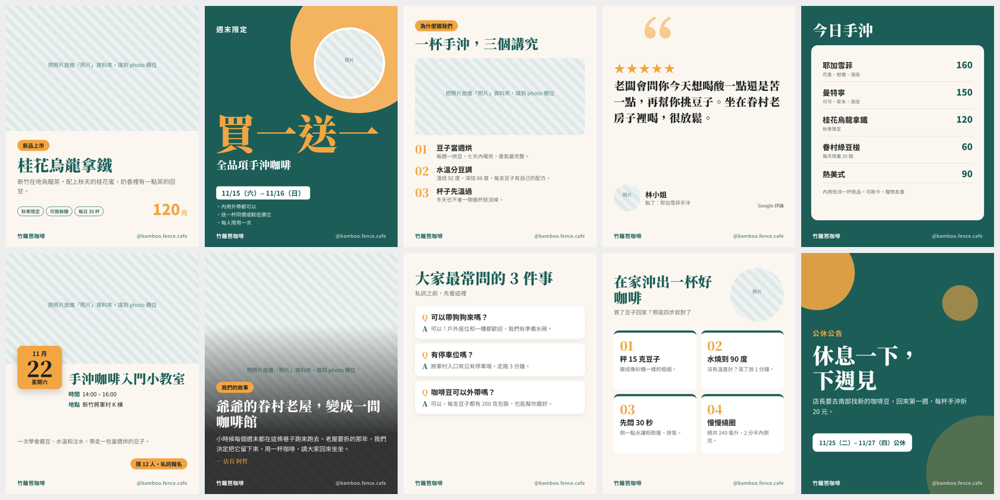
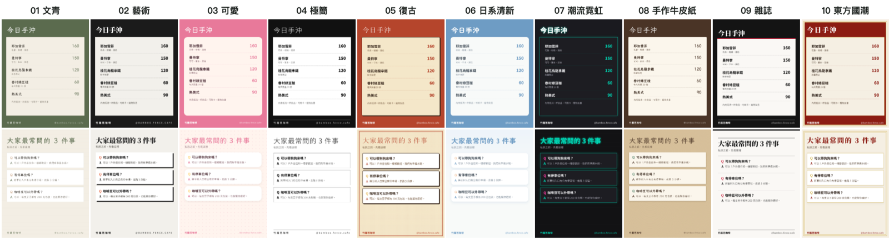

# brand｜品牌大腦＋10 張社群文圖模板

Eric Lu 盧旭熙「品牌行銷 AI 加速器」課程模板，給小店家和個人品牌用：
先把店的資料整理成 AI 讀得懂的「品牌大腦」（Obsidian 筆記），再用 10 張寫好的模板，讓 AI 幾秒鐘填出 IG、FB、LinkedIn 都能用的圖和文案。

- 講師：Eric Lu 盧旭熙｜熱火數碼資訊執行長、WPORT 職航站創辦人
- 個人網站：https://sup-eric.com
- 範例店「竹籬笆咖啡」是虛構的，請換成你自己的店。

## 為什麼模板是程式碼？

叫 AI 從零畫一張圖，免費模型要等很久，每次排版還都不一樣。
這裡的模板已經把版型寫死了，AI 只需要改最下面一小段 JSON（店名、標題、價格、照片路徑），輸出很短，免費模型也跑得快，而且每一張都是你的品牌色。

## 三步驟開始

1. 下載：`git clone https://github.com/contactwport/wport-ai-starter-kit.git _kit`，把 `_kit/brand` 裡的東西搬到你的資料夾（例如桌面的 `my-brand`），再刪掉 `_kit`。
2. 用 Obsidian 打開資料夾，把 `品牌資料/` 換成你的店。不知道怎麼寫，請 AI 訪問你、幫你填。
3. 叫 AI 做圖：「用模板 01，讀品牌資料，幫我做桂花烏龍拿鐵的新品文圖，輸出成圖片」。AI 會照 `AGENTS.md` 的規則做。

## 10 張模板

| 編號 | 名稱 | 什麼時候用 | 檔案 |
|---|---|---|---|
| 01 | 新品上市 | 新商品、新口味、季節限定上架時用 | `templates/01-new-product.html` |
| 02 | 限時優惠 | 折扣、買一送一、會員日、週年慶 | `templates/02-sale.html` |
| 03 | 三個賣點 | 介紹一個商品或服務為什麼值得買 | `templates/03-three-points.html` |
| 04 | 客人好評 | 把客人的真實評論做成圖（記得先問客人同意） | `templates/04-review.html` |
| 05 | 價目表 | 菜單、服務價目、課程方案 | `templates/05-menu.html` |
| 06 | 活動公告 | 市集、課程、講座、快閃活動 | `templates/06-event.html` |
| 07 | 品牌故事 | 創業故事、職人日常、幕後花絮 | `templates/07-story.html` |
| 08 | 常見問答 | 客人最常私訊問的三個問題 | `templates/08-faq.html` |
| 09 | 使用步驟 | 教學、預約流程、怎麼用、怎麼買 | `templates/09-steps.html` |
| 10 | 節日與公告 | 節日問候、公休、營業時間異動 | `templates/10-notice.html` |

## 10 種風格

同一份資料，換一行就換整套風格。打開 `templates/theme.css`，把 `00-default` 換成下面的檔名：

| 檔名 | 風格 | 感覺 |
|---|---|---|
| `01-literary` | 文青 | 米白紙、橄欖綠、楷體，照片像沖洗相片 |
| `02-art` | 藝術 | 黑白高反差＋朱紅色塊，畫廊感 |
| `03-cute` | 可愛 | 粉紅奶油色、圓體、點點底 |
| `04-minimal` | 極簡 | 純白、細線、大量留白 |
| `05-retro` | 復古 | 七〇年代老招牌，芥末黃、磚紅、網點 |
| `06-fresh` | 日系清新 | 淡藍、杏色、圓體、柔和圓角 |
| `07-neon` | 潮流霓虹 | 黑底、螢光粉綠、發光字 |
| `08-handmade` | 手作牛皮紙 | 牛皮紙、手寫字、紙膠帶照片 |
| `09-magazine` | 雜誌 | 明體大標、黑白＋紅、分欄細線 |
| `10-oriental` | 東方國潮 | 朱紅、金色、宋體、印章標籤 |

先比較再決定：`node scripts/render.mjs 01 --theme=all`，10 種風格的圖會出現在 `out/themes/`。
選好之後想保留自己的品牌色，在 `theme.css` 最下面加一行 `:root{--main:#你的主色;--accent:#你的強調色}`。

## 指令

| 要做什麼 | 指令 |
|---|---|
| 輸出全部模板成圖片 | `node scripts/render.mjs` |
| 只輸出 01 和 05 | `node scripts/render.mjs 01 05` |
| 用 10 種風格各輸出一次 | `node scripts/render.mjs 01 --theme=all` |
| 只試可愛風 | `node scripts/render.mjs 01 --theme=03` |
| 發到 FB 粉專（試跑） | `node scripts/post-fb.mjs out/01-new-product.png out/01-new-product.fb.txt` |
| 真的發出去 | 同上，最後加 `--live` |

需要 Node.js 20 以上，以及電腦裡有 Chrome 或 Edge。發 FB 要先照 `.env.example` 建 `.env`，填粉專 ID 和粉專權杖。

## IG 和 LinkedIn

- **IG**：要先把 IG 改成專業帳號、連到 FB 粉專，再用同一個 Meta App 拿 `instagram_content_publish` 權限。IG 發圖要給公開的圖片網址，不能直接上傳檔案。
- **LinkedIn**：個人頁要建 LinkedIn App、開 `w_member_social` 權限拿權杖；公司頁要再通過審核。
- 這兩個課堂上示範，課後照講義設定。

## 不要放進 repo 的東西

- `.env`（金鑰、權杖）已經寫在 `.gitignore`，不會傳上去。公用電腦下課前請刪掉。
- 手機、地址、身分證字號、銀行帳號這類私人資料。
- 沒問過的客人照片。

---

模板來自 [Eric Lu 盧旭熙](https://sup-eric.com)。做出圖之後，歡迎到 [Instagram](https://www.instagram.com/eric_rookie_ceo/) 或 [LinkedIn](https://www.linkedin.com/in/xu-xi-lu-922823b9/) tag 我。
